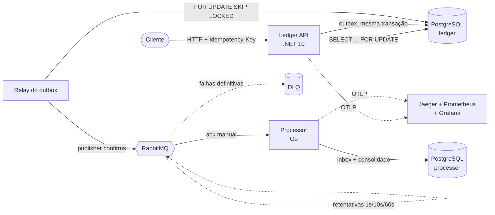

# PayFlow

[](https://github.com/alaxpereira/payflow/actions/workflows/ledger-ci.yml)
[](https://github.com/alaxpereira/payflow/actions/workflows/processor-ci.yml)
[](https://github.com/alaxpereira/payflow/actions/workflows/e2e.yml)


[](LICENSE)

Uma plataforma de pagamentos simplificada, construída como um conjunto de serviços poliglotas (**C# / .NET** e
**Go**), com foco nas partes difíceis de movimentar dinheiro: consistência, idempotência, concorrência e mensageria
confiável.

> Projeto de portfólio. O objetivo não é ter muitas funcionalidades, e sim mostrar como um sistema de pagamentos real
> lida com gasto duplo, retentativas, falhas parciais e observabilidade.

## Arquitetura



| Serviço | Linguagem | Responsabilidade | Status |
|---|---|---|---|
| `services/ledger` | C# / .NET 10 | Contas, saldos, livro-razão em partida dobrada, depósitos, transferências e relay do outbox | Fases 1 e 2 ✅ |
| `services/processor` | Go | Consome eventos e mantém o consolidado diário por moeda e tipo de transação | Fase 2 ✅ |

O fluxo de mensagens, as garantias de entrega e o contrato dos eventos estão em
[`docs/mensageria.md`](docs/mensageria.md). Traces, métricas e dashboards estão em
[`docs/observabilidade.md`](docs/observabilidade.md).

### Sob carga

A **100 transferências/s** (mais retentativas e um cenário de contenção nas mesmas contas), o p95 fica em
**55 ms** com tudo rodando numa máquina de 4 vCPUs. Depois da carga, os bancos são conferidos: o dinheiro é
conservado até o centavo, nenhuma conta fica negativa e o consolidado do processor bate com o ledger, sem
duplicatas. Números completos e como reproduzir em [`docs/benchmark.md`](docs/benchmark.md).

## Principais decisões de design

- **Dinheiro como inteiro em centavos** (`long`). Nada de ponto flutuante perto de um saldo.
- **Livro-razão em partida dobrada.** Toda transação gera lançamentos; uma transferência gera um débito e um crédito
  que sempre somam zero, e cada lançamento registra o saldo resultante (extrato auditável).
- **Lock pessimista nas alterações de saldo.** As contas envolvidas numa transação são travadas com
  `SELECT ... FOR UPDATE ORDER BY id`. Travar sempre na mesma ordem evita deadlock entre transferências opostas
  (A→B e B→A ao mesmo tempo). Uma constraint `CHECK (balance >= 0)` é a última linha de defesa.
- **Idempotência no próprio modelo de dados.** Operações `POST` exigem o header `Idempotency-Key`. A chave é gravada
  junto com a transação, com índice único, na mesma transação de banco que altera o saldo. Assim, uma retentativa
  depois de um timeout nunca cobra duas vezes. Reutilizar a chave com outro payload é rejeitado (`409`). Uma
  requisição repetida devolve o resultado original com `Idempotent-Replayed: true`.
- **Transactional outbox.** Um interceptor do EF Core converte eventos de domínio em linhas de `outbox_messages`
  durante o `SaveChanges`, de forma atômica com a mudança de negócio. Um relay em background publica essas linhas no
  RabbitMQ com *publisher confirms* e `FOR UPDATE SKIP LOCKED`, então várias instâncias da API podem rodar o relay
  sem publicar a mesma mensagem duas vezes no mesmo instante.
- **At-least-once na entrega, exatamente uma vez no efeito.** O relay e o RabbitMQ podem entregar uma mensagem mais
  de uma vez. O processor usa o padrão *inbox*: grava o `message_id` e atualiza o consolidado no mesmo commit, então
  uma entrega duplicada não muda nada.
- **Retentativas sem bloquear a fila.** Erros transitórios voltam com backoff (1s → 10s → 60s) através de uma fila
  de espera por atraso. Erros permanentes, como um payload inválido, vão direto para a DLQ com o motivo nos headers.
  Uma *alternate exchange* guarda eventos que ainda não têm nenhum consumidor, em vez de descartá-los.
- **Um trace do HTTP ao consolidado.** O `traceparent` da requisição é gravado na linha do outbox, então o trace
  continua mesmo com a publicação acontecendo depois de a requisição terminar. Ele segue no header AMQP até o
  processor em Go. No Jaeger, uma transferência aparece como um único trace com spans dos dois serviços.
- **Clean Architecture sem cerimônia.** Domain → Application → Infrastructure → API, com um tipo `Result` simples
  para falhas de negócio esperadas (em vez de exceções) e handlers como classes comuns (sem biblioteca de mediator).

## Rodando localmente

Requisito: Docker. Para rodar os testes fora do Docker, também .NET 10 SDK e Go 1.27.

```bash
docker compose up --build
```

| Serviço | Endereço |
|---|---|
| Ledger API | `http://localhost:8080` (OpenAPI em `/openapi/v1.json`) |
| Processor | `http://localhost:8081/settlements?date=AAAA-MM-DD` |
| Painel do RabbitMQ | `http://localhost:15672` (usuário e senha `payflow`) |
| Grafana (dashboard PayFlow) | `http://localhost:3000` |
| Jaeger (traces) | `http://localhost:16686` |

Teste as requisições em [`services/ledger/requests.http`](services/ledger/requests.http). Depois de um depósito ou
transferência, o consolidado do dia aparece no processor em cerca de um segundo.

### Testes

```bash
cd services/ledger
dotnet test

cd services/processor
go test ./...                     # unitários
go test -tags integration ./...   # integração (exige Docker)
```

- **Testes unitários** cobrem as regras de domínio, o fluxo de idempotência e a política de retentativas.
- **Testes de integração** sobem os serviços reais contra PostgreSQL e RabbitMQ em containers (Testcontainers):
  transferências simultâneas que nunca deixam a conta negativa, o relay publicando no RabbitMQ, o processor
  ignorando entregas duplicadas e mandando mensagens inválidas para a DLQ.

## API

| Método | Rota | Descrição |
|---|---|---|
| `POST` | `/accounts` | Abre uma conta |
| `GET` | `/accounts/{id}` | Dados e saldo da conta |
| `GET` | `/accounts/{id}/statement` | Extrato paginado |
| `POST` | `/accounts/{id}/deposits` | Depósito (exige `Idempotency-Key`) |
| `POST` | `/transfers` | Transferência entre contas (exige `Idempotency-Key`) |
| `GET` | `/transactions/{id}` | Detalhes de uma transação |

## Roadmap

- [x] **Fase 1** – Ledger API: contas, depósitos, transferências, idempotência, locks, outbox, testes, CI
- [x] **Fase 2** – Relay do outbox + RabbitMQ + processor em Go (retentativas com backoff, dead-letter queue)
- [x] **Fase 3** – Observabilidade: traces com OpenTelemetry atravessando C# → fila → Go, dashboards no Grafana
- [x] **Fase 4a** – Teste de carga com k6 no CI, com verificação de consistência ([resultados](docs/benchmark.md))
- [ ] **Fase 4b** – Deploy na Oracle Cloud (configuração e guia prontos em [`deploy/oracle`](deploy/oracle/README.md))
