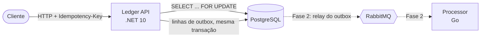

# PayFlow

Uma plataforma de pagamentos simplificada, construída como um conjunto de serviços poliglotas (**C# / .NET** e
**Go**), com foco nas partes difíceis de movimentar dinheiro: consistência, idempotência, concorrência e mensageria
confiável.

> Projeto de portfólio. O objetivo não é ter muitas funcionalidades, e sim mostrar como um sistema de pagamentos real
> lida com gasto duplo, retentativas, falhas parciais e observabilidade.

## Arquitetura



| Serviço | Linguagem | Responsabilidade | Status |
|---|---|---|---|
| `services/ledger` | C# / .NET 10 | Contas, saldos, livro-razão em partida dobrada, depósitos e transferências | Fase 1 ✅ |
| `services/processor` | Go | Consumo de eventos, conciliação, liquidação | Fase 2 |

## Principais decisões de design

- **Dinheiro como inteiro em centavos** (`long`). Nada de ponto flutuante perto de um saldo.
- **Livro-razão em partida dobrada.** Toda transação gera lançamentos; uma transferência gera um débito e um crédito
  que sempre somam zero, e cada lançamento registra o saldo resultante (extrato auditável).
- **Lock pessimista nas alterações de saldo.** As contas envolvidas numa transação são travadas com
  `SELECT ... FOR UPDATE ORDER BY id`. Travar sempre na mesma ordem evita deadlock entre transferências opostas
  (A→B e B→A ao mesmo tempo). Uma constraint `CHECK (balance >= 0)` é a última linha de defesa.
- **Idempotência no próprio modelo de dados.** Operações `POST` exigem o header `Idempotency-Key`. A chave é gravada
  junto com a transação, com índice único, na mesma transação de banco que altera o saldo. Assim, uma retentativa
  depois de um timeout nunca cobra duas vezes. Reutilizar a chave com outro payload é rejeitado (`409`). Uma
  requisição repetida devolve o resultado original com `Idempotent-Replayed: true`.
- **Transactional outbox.** Um interceptor do EF Core converte eventos de domínio em linhas de `outbox_messages`
  durante o `SaveChanges`, de forma atômica com a mudança de negócio. A Fase 2 adiciona o relay que publica esses
  eventos.
- **Clean Architecture sem cerimônia.** Domain → Application → Infrastructure → API, com um tipo `Result` simples
  para falhas de negócio esperadas (em vez de exceções) e handlers como classes comuns (sem biblioteca de mediator).

## Rodando localmente

Requisitos: .NET 10 SDK e Docker.

```bash
docker compose up --build
```

A API sobe em `http://localhost:8080`. Teste as requisições em
[`services/ledger/requests.http`](services/ledger/requests.http), ou abra o documento OpenAPI em `/openapi/v1.json`
rodando em Development.

### Testes

```bash
cd services/ledger
dotnet test
```

- **Testes unitários** cobrem as regras de domínio e o fluxo de idempotência.
- **Testes de integração** sobem a API real contra um PostgreSQL em container (Testcontainers), incluindo um teste
  que dispara transferências simultâneas contra a mesma conta e garante que ela nunca fica negativa. Exigem Docker.

## API

| Método | Rota | Descrição |
|---|---|---|
| `POST` | `/accounts` | Abre uma conta |
| `GET` | `/accounts/{id}` | Dados e saldo da conta |
| `GET` | `/accounts/{id}/statement` | Extrato paginado |
| `POST` | `/accounts/{id}/deposits` | Depósito (exige `Idempotency-Key`) |
| `POST` | `/transfers` | Transferência entre contas (exige `Idempotency-Key`) |
| `GET` | `/transactions/{id}` | Detalhes de uma transação |

## Roadmap

- [x] **Fase 1** – Ledger API: contas, depósitos, transferências, idempotência, locks, outbox, testes, CI
- [ ] **Fase 2** – Relay do outbox + RabbitMQ + processor em Go (retentativas com backoff, dead-letter queue)
- [ ] **Fase 3** – Observabilidade: traces com OpenTelemetry atravessando C# → fila → Go, dashboards no Grafana
- [ ] **Fase 4** – Deploy em nuvem e teste de carga com k6 (resultados publicados)
