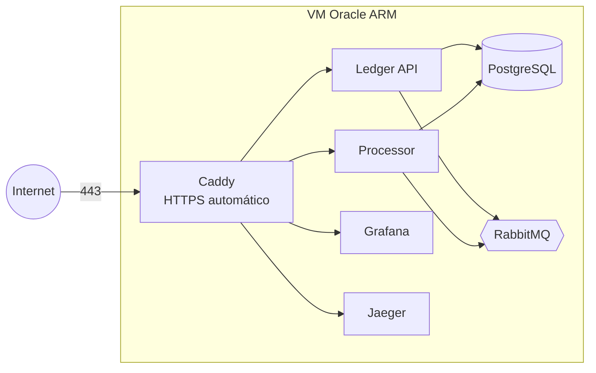

# Deploy na Oracle Cloud (Always Free)

A stack inteira roda numa única VM ARM do plano Always Free (4 vCPUs, 24 GB de RAM, sem custo), com o Docker
Compose e o Caddy na frente cuidando do HTTPS. Sem domínio próprio: o [sslip.io](https://sslip.io) transforma o IP
da VM num nome que a Let's Encrypt aceita.



## 1. Conta

Crie a conta em https://www.oracle.com/cloud/free/. Ela pede um cartão só para verificar a identidade; os
recursos *Always Free* não são cobrados. A aprovação às vezes leva algumas horas.

Na criação, a **home region** não pode ser trocada depois e é onde os recursos gratuitos ficam. **Brazil East
(São Paulo)** é a mais próxima.

## 2. Liberar as portas 80 e 443 na rede

**Networking → Virtual cloud networks →** a VCN criada junto com a conta (ou crie uma com o assistente *VCN
Wizard*) **→ Security Lists → Default Security List → Add Ingress Rules**:

| Source CIDR | IP Protocol | Destination Port |
|---|---|---|
| `0.0.0.0/0` | TCP | `80` |
| `0.0.0.0/0` | TCP | `443` |

## 3. Criar a VM

**Compute → Instances → Create instance**:

- **Image:** Canonical Ubuntu 24.04.
- **Shape:** *Change shape → Ampere → VM.Standard.A1.Flex*, com **4 OCPUs e 24 GB** (o máximo do Always Free).
- **Networking:** a VCN do passo anterior, sub-rede pública, com *Assign a public IPv4 address* marcado.
- **SSH keys:** *Generate a key pair for me* e **baixe a chave privada** (sem ela não dá para entrar na VM).
- **Advanced options → Management → Cloud-init script:** cole o conteúdo de
  [`cloud-init.yaml`](cloud-init.yaml). Ele instala o Docker, libera o firewall da própria VM e clona o projeto.

Se aparecer **"Out of capacity"**, é falta de máquinas ARM livres na região naquele momento: tente outro
*Availability Domain* ou de novo mais tarde.

## 4. Configurar

Anote o **IP público** da instância e entre nela. No Windows, o PowerShell já tem `ssh`:

```bash
ssh -i caminho\da\chave.key ubuntu@IP_DA_VM
```

O cloud-init leva uns minutos depois que a VM sobe. Confira se terminou:

```bash
cloud-init status --wait
```

Crie o `.env` a partir do modelo e preencha:

```bash
cd /opt/payflow
cp deploy/oracle/.env.example .env
openssl rand -hex 24   # rode uma vez para cada senha
nano .env
```

`DOMAIN` é o IP com `.sslip.io` no fim, por exemplo `129.146.10.20.sslip.io`.

## 5. Subir

```bash
docker compose -f docker-compose.yml -f docker-compose.prod.yml up -d --build
```

A primeira vez leva de 5 a 10 minutos (compila os dois serviços para ARM). Depois:

| Serviço | Endereço |
|---|---|
| API | `https://api.SEU_DOMAIN/health` |
| Consolidado | `https://processor.SEU_DOMAIN/settlements?date=AAAA-MM-DD` |
| Grafana | `https://grafana.SEU_DOMAIN` (visitante só lê; admin com a senha do `.env`) |
| Jaeger | `https://jaeger.SEU_DOMAIN` |

## Atualizar

```bash
cd /opt/payflow
git pull
docker compose -f docker-compose.yml -f docker-compose.prod.yml up -d --build
```

## O que fica exposto, e o que não

- Só o Caddy escuta na internet (80 e 443). PostgreSQL, RabbitMQ, Prometheus e as portas dos serviços ficam na
  rede interna do Docker.
- A API tem **limite de requisições por IP** (`API_RATE_LIMIT_PER_MINUTE`, padrão 120/min), para a demo pública
  não poder ser derrubada nem ter o banco enchido.
- O Grafana aceita visitantes só para leitura; o Jaeger é aberto. Os traces só têm IDs e valores de contas de
  teste.
- O dinheiro é de mentira: não há autenticação de usuário na API. Isso é uma demo, não um banco.

## Cuidados com o Always Free

A Oracle pode **recuperar instâncias Always Free ociosas** (CPU, rede e memória muito baixas por 7 dias). Uma demo
com pouco tráfego pode cair nessa regra. Migrar a conta para *Pay As You Go* evita isso e continua sem custo
enquanto o uso ficar dentro dos limites gratuitos (vale configurar um alerta de orçamento de US$ 1 por segurança).
