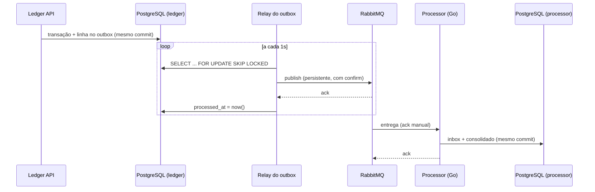

# Mensageria

Como os eventos saem do ledger e chegam ao processor, e o que cada lado garante.

## Fluxo



## Garantias

| Etapa | Garantia | Como |
|---|---|---|
| API → outbox | Atômica | O evento é gravado na mesma transação da mudança de saldo |
| Outbox → RabbitMQ | At-least-once | Só marca como publicado depois do *publisher confirm*. Se cair no meio, publica de novo |
| RabbitMQ → processor | At-least-once | Ack manual, só depois do commit no banco |
| Efeito no processor | Exatamente uma vez | Inbox: `processed_messages` com `message_id` como chave primária, no mesmo commit do consolidado |

**Ordem não é garantida.** Com várias instâncias do relay (`SKIP LOCKED`) e retentativas, mensagens podem chegar
fora de ordem. O consolidado é uma soma, então a ordem não importa. Um consumidor que dependa de ordem precisaria
de um número de sequência por agregado.

## Topologia

| Nome | Tipo | Declarado por | Detalhes |
|---|---|---|---|
| `payflow.events` | exchange topic | ledger e processor | `alternate-exchange = payflow.events.unrouted` |
| `payflow.events.unrouted` | exchange fanout + fila quorum | ledger e processor | Recebe eventos sem nenhuma fila interessada (ex.: `AccountOpened` hoje). `x-max-length = 100000` |
| `processor.transactions` | fila quorum | processor | Bind em `ledger.transaction_completed` |
| `processor.transactions.retry.{N}ms` | filas quorum | processor | Uma por atraso (1s, 10s, 60s). Ao expirar, a mensagem volta para a fila principal |
| `processor.transactions.dlq` | fila quorum | processor | Destino final: erros permanentes ou retentativas esgotadas |

As duas exchanges compartilhadas são declaradas pelos dois serviços com **argumentos idênticos**, inclusive o tipo
numérico (`x-max-length` é `int32` nos dois). Se divergirem, o RabbitMQ recusa a declaração com
`PRECONDITION_FAILED`. Assim, qualquer serviço pode subir primeiro.

### Por que uma fila de retentativa por atraso?

O RabbitMQ só expira mensagens que estão no **início** da fila. Numa fila única com TTL por mensagem, uma mensagem
de 60s na frente seguraria uma de 1s logo atrás. Com uma fila por atraso, todas as mensagens de uma fila têm o
mesmo TTL e expiram em ordem.

### Erros permanentes vs. transitórios

- **Permanente** (JSON malformado, campo inválido, sem `message_id`): vai **direto para a DLQ**. Reenviar não
  vai fazer dar certo e só atrasa as outras mensagens.
- **Transitório** (banco fora do ar, timeout): retentativa com backoff (1s → 10s → 60s), depois DLQ.

Toda mensagem republicada carrega `x-retry-count` e `x-last-error` nos headers, para investigar a DLQ.

## Contrato: `TransactionCompleted`

Routing key `ledger.transaction_completed`. Propriedades AMQP: `message_id` (Id da linha do outbox, estável entre
republicações), `type = TransactionCompleted`, `content_type = application/json`, `delivery_mode = 2`.

```json
{
  "transactionId": "0192d6a1-7c3e-7a10-8000-000000000001",
  "kind": "Transfer",
  "sourceAccountId": "0192d6a1-7c3e-7a10-8000-000000000002",
  "destinationAccountId": "0192d6a1-7c3e-7a10-8000-000000000003",
  "amount": 2500,
  "currency": "BRL",
  "occurredAt": "2026-10-24T12:00:00+00:00"
}
```

- `kind`: `Deposit` ou `Transfer`. Em depósitos, `sourceAccountId` é `null`.
- `amount`: centavos, sempre positivo.
