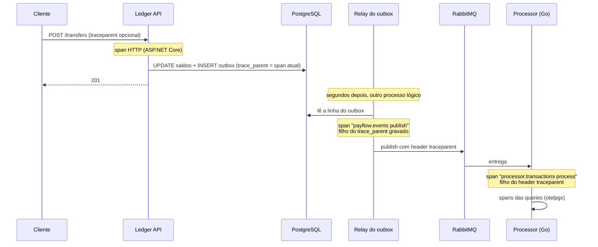

# Observabilidade

Traces e métricas com OpenTelemetry nos dois serviços. Um único trace acompanha uma transferência desde o
`POST /transfers` no ledger até a linha do consolidado no processor, passando pelo outbox e pelo RabbitMQ.

```bash
docker compose up --build
```

| Ferramenta | Endereço | Para quê |
|---|---|---|
| Grafana | http://localhost:3000 | Dashboard **PayFlow** (abre direto na página inicial) |
| Jaeger | http://localhost:16686 | Traces: procure por `payflow-ledger` |
| Prometheus | http://localhost:9090 | Consultas PromQL avulsas |

## Como o trace atravessa o sistema



O ponto que costuma quebrar o trace em sistemas com outbox: **a requisição HTTP termina antes de o evento ser
publicado**, então não existe mais um span "atual" quando o relay roda. A solução é gravar o contexto W3C
(`traceparent`) na própria linha do outbox, no mesmo commit do evento, e o relay criar o span de publicação como
filho desse contexto. No processor, o contexto vem no header AMQP `traceparent`. Nas retentativas, o header é
atualizado com o span da tentativa que falhou, então todas as tentativas aparecem encadeadas no mesmo trace.

Os testes de integração dos dois lados verificam isso: no ledger, o trace ID de uma requisição chega ao header da
mensagem; no processor, o span de consumo é filho do `traceparent` recebido e as queries são filhas dele.

## Métricas

Além das métricas HTTP e de runtime padrão, as de negócio:

| Métrica (Prometheus) | Serviço | O que mostra |
|---|---|---|
| `payflow_ledger_transactions_total{kind,currency}` | ledger | Transações concluídas (contadas só depois do commit) |
| `payflow_ledger_idempotent_replays_total` | ledger | Retentativas de cliente respondidas pela idempotência |
| `payflow_outbox_publish_delay_seconds` | ledger | Tempo entre gravar o evento e o broker confirmar |
| `payflow_outbox_publish_failures_total` | ledger | Falhas de publicação (broker fora, por exemplo) |
| `payflow_processor_messages_total{outcome}` | processor | `processed`, `retried` ou `dead_lettered` |
| `payflow_processor_end_to_end_lag_seconds` | processor | Da transação no ledger até entrar no consolidado |
| `payflow_processor_duplicates_total` | processor | Entregas duplicadas descartadas pelo inbox |
| `payflow_processor_processing_duration_seconds` | processor | Tempo de processamento de uma mensagem |

Sugestões de alerta: `dead_lettered` acima de zero, `payflow_outbox_publish_failures_total` crescendo e p95 do
`end_to_end_lag` acima de alguns segundos (indica outbox ou fila acumulando).

## Decisões

- **Sem OpenTelemetry Collector, por enquanto.** Cada serviço envia OTLP direto: traces para o Jaeger v2 (que já é
  construído sobre o Collector) e métricas para o receptor OTLP nativo do Prometheus 3. Menos peças para um ambiente
  local. Em produção, um Collector no meio permitiria amostragem, filtros e trocar de backend sem mexer nos serviços.
- **Coleta sempre ligada, exportação opcional.** Os spans são criados mesmo sem endpoint configurado (é o que
  permite propagar o contexto e testá-lo); só a exportação depende de `Telemetry:*Endpoint` no ledger e de
  `OTEL_EXPORTER_OTLP_*_ENDPOINT` no processor.
- **Logs com trace ID.** Os logs dos dois serviços incluem o trace ID, para ir de uma linha de log ao trace no
  Jaeger.

## Teste ponta a ponta

[`scripts/e2e.sh`](../scripts/e2e.sh) roda no CI a cada PR: sobe o compose inteiro, faz uma transferência com um
trace ID conhecido e confere que o trace no Jaeger tem spans dos dois serviços, que as métricas chegaram ao
Prometheus e que o dashboard foi provisionado no Grafana.
